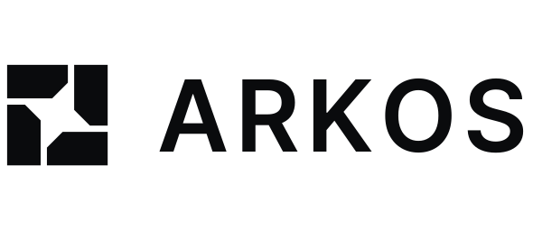
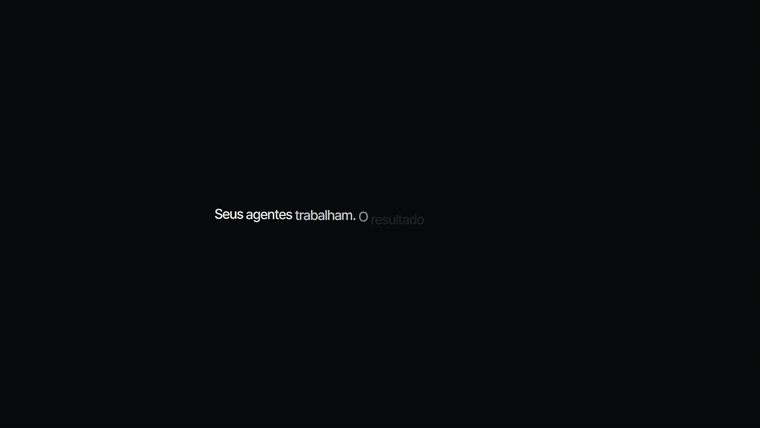

<p align="center">
  <picture>
    <source media="(prefers-color-scheme: dark)" srcset="docs/arkos-logo-escuro.svg">
    
  </picture>
</p>

<p align="center">
  <b>Advanced Resource &amp; Knowledge Orchestration System</b><br>
  Framework de IA sobre o Claude Code para os prestadores da Endstate.
</p>

<p align="center">
  <a href="#instalar">Instalar</a> ·
  <a href="#o-que-a-arkos-faz">O que faz</a> ·
  <a href="#como-funciona">Como funciona</a> ·
  <a href="#planos-e-chave">Planos</a> ·
  <a href="#perguntas">Perguntas</a>
</p>

---

## A ARKOS em 45 segundos

<p align="center">
  <a href="docs/arkos-demo.mp4">
    
  </a>
  <br>
  <sub>Clique para assistir ao vídeo completo com som (45 s): uma correção de frete no checkout, do comando ao relatório.</sub>
</p>

Seus agentes trabalham, mas o resultado se perde no terminal. Na ARKOS, tudo começa com um comando: ela orquestra recursos e conhecimento, e cada execução vira um relatório.

## O que a ARKOS faz

Você digita `arkos` no lugar de `claude`. O Claude Code abre com a camada da ARKOS:

- **28 módulos em sete capítulos**, entre eles programação, infraestrutura e deploy, design, vídeo, conteúdo, SEO, growth, tráfego pago, vendas, CRM, estratégia e operação. O classificador lê o pedido, em português ou em inglês, e escolhe o módulo.
- **Playbooks.** Cada pedido segue um passo a passo, com perguntas de entrada antes de agir. Por exemplo, o mercado (Brasil, EUA ou Europa) vem antes de qualquer prospecção.
- **Base de conhecimento protegida.** O terminal consulta o método da ARKOS por MCP. Você recebe a resposta aplicada ao seu caso, nunca o documento inteiro.
- **Portão de qualidade.** Um checklist roda antes de toda entrega: o relatório só fecha completo e acionável.
- **Notas de 0 a 100.** Réguas próprias dão nota a criativo, oferta, copy, nicho, prospect e projeto, com a evidência de cada critério e as três correções que mais sobem a nota.
- **Relatório local.** Ao fim de cada execução, a ARKOS monta um site na sua máquina com título, resumo, passos, status e log. Ele abre sem servidor, sem conta e sem internet.
- **Executa com a sua aprovação.** Envios, gastos e publicações nas contas do cliente esperam o seu sim.

## Como funciona

```text
PS C:\projetos\loja-web> arkos "corrigir o cálculo de frete no checkout"

ARKOS ENGINE   run arkos-0042 · Claude Code
plano      5 passos
recursos   repo · terminal · navegador · testes
executando 01/05 ler o código do checkout
```

1. **Pergunta antes de agir.** O playbook abre com as perguntas de entrada.
2. **Escolhe módulo e skills.** O classificador monta o caminho e recomenda as ferramentas daquele passo.
3. **Consulta a base.** A busca traz trechos curtos e curados, e cada consulta é registrada.
4. **Executa com aprovação.** O rodapé mostra o passo atual (`passo 2/4`). No fim, o relatório local abre sozinho.

## Instalar

Windows, PowerShell:

```powershell
irm https://raw.githubusercontent.com/SystemEndstate/arkos/main/install.ps1 | iex
```

Requisitos: Node 18+ e [Claude Code](https://claude.com/claude-code). O instalador pede a sua chave ARKOS (`ARK1...`) e o endereço da base.
Depois rode `arkos` num terminal novo.

## Atualizar

O `arkos` confere a versão ao abrir e se atualiza sozinho. Para atualizar à mão: `arkos update`.
Para desligar a atualização automática, coloque `"atualizacao": { "auto": false }` em `~/.arkos/config.json`.

## Planos e chave

A ARKOS funciona com uma chave entregue pela Endstate. Ela fica em `~/.arkos/licenca.txt`, e cada consulta à base confere a chave no servidor da ARKOS.

| | Membro | VIP |
|---|---|---|
| Módulos, playbooks e base de conhecimento | sim | sim |
| Relatório local, portão de qualidade e notas | sim | sim |
| Áreas avançadas e pacote completo de ferramentas | — | sim |

Com a chave VIP, o pacote VIP é baixado do servidor e se atualiza junto com o terminal. Chave alterada à mão é recusada.

## Perguntas

**Preciso de internet?**
Só para consultar a base e para atualizar. O relatório local abre offline.

**Meus dados e os do cliente saem da máquina?**
Os arquivos do projeto ficam na sua máquina. Para a base vai só a pergunta da consulta.

**Como consigo uma chave?**
Fale com a Endstate. O acesso é para os prestadores da empresa.

---

<p align="center">
  <sub>ARKOS · uma tecnologia <b>Endstate</b></sub>
</p>
